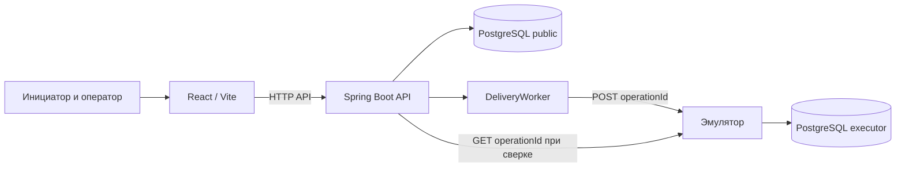
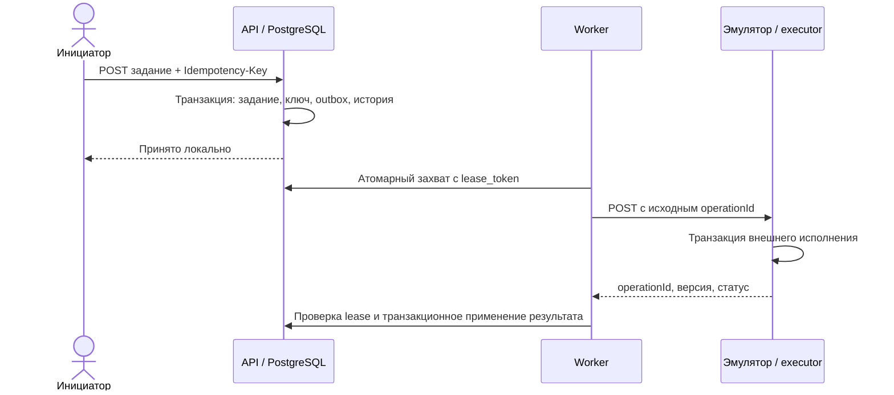

# Архитектура системы обмена

Приложение принимает задания инициаторов, сохраняет их в PostgreSQL и доставляет отдельному эмулятору исполнителя. React/TypeScript/Vite показывает данные API; Spring Boot проверяет права, сохраняет изменения и выполняет фоновую доставку. В демонстрационной конфигурации обе стороны используют один сервер PostgreSQL в разных схемах.

## Создание и доставка

Инициатор отправляет `POST /api/tasks` с `Idempotency-Key`. В одной транзакции сохраняются задание, хэш запроса и outbox; повтор пользователя с тем же ключом и содержимым возвращает прежнюю запись, несовпадение даёт 409. UUID задания служит неизменным `operationId` для доставки. После commit воркер захватывает подходящую запись через PostgreSQL и отправляет её эмулятору. Внешняя сторона фиксирует содержимое и результат по уникальному `operationId`, поэтому повтор после потери ответа не создаёт второе исполнение.

Outbox хранит попытки, время следующей попытки и lease. Истёкший lease доступен новому воркеру; ответ с устаревшим токеном не применяется. При временной ошибке выполняется ограниченный повтор с задержкой; после исчерпания попыток состояние доставки становится `FAILED`. Некорректный или противоречивый ответ требует разбора (`REVIEW`). Проверка и обновление задания, outbox и истории выполняются локально одной транзакцией.

В штатном режиме один синхронный worker за тик обрабатывает не более 16 готовых записей. Он захватывает запись непосредственно перед её HTTP-вызовом, поэтому lease не простаивают в очереди уже захваченных задач; после пустой очереди следующий опрос ждёт стандартные 1000 мс. Параллельные доставки не включены. Для измерений worker пишет раздельные длительности claim, HTTP и локального apply. Эмулятор отдельно пишет время получения JDBC-соединения, блокировки `fault_modes` и транзакции внешнего ledger.

Доставка (`READY`, `DONE`, `FAILED`, `REVIEW`) и бизнес-исполнение (`PENDING`, `SUCCEEDED`, `FAILED`) отображаются отдельно. Внешнее исполнение может уже состояться, пока локальная доставка ещё не подтверждена. История попыток и конфликты доступны оператору в его области.

## Сверка и восстановление

Сверка делает независимый `GET /operations/{operationId}` и сохраняет локальный и внешний снимки, автора, время и исход: совпадение, расхождение, отсутствие, недоступность или некорректный ответ. Сама сверка не изменяет бизнес-результат. Оператор отдельно подтверждает применение; внешний снимок перечитывается без локальных блокировок, затем короткая транзакция повторно проверяет доступ и актуальность данных. Устаревшее решение возвращает 409. Между внешним чтением и локальным commit нет распределённой транзакции.

Ручной повтор допускается при отсутствии активного захвата и подтверждённого результата. Команда, аудит и постановка outbox записываются атомарно; ключ команды защищает от повторной постановки, а исходный `operationId` и история сохраняются. Изменение ответственного имеет отдельную локальную версию и транзакционный аудит.

## Доступ и хранение

Демонстрационные пользователи `alice` и `bob` имеют роль INITIATOR и видят свои задания; `operator` имеет роль OPERATOR и видит владельцев из `operator_scope` (по умолчанию Alice). Проверки выполняются на сервере. Учётные записи и Basic-аутентификация предназначены для локального демо.

Flyway применяет миграции `backend/src/main/resources/db/migration/V1…V7`: `tasks`, `outbox`, `exchange_events`, `result_conflicts`, `operator_scope`, `reconciliations`, `recovery_commands` и `assignment_audit`. Эмулятор создаёт `executor.executions` и `executor.fault_modes` при старте. Метки времени хранятся как `timestamptz`; API и UI используют UTC. Подробные контракты и правила — в [API](api.md) и [интеграции](integrations.md); проверки и результаты нагрузки — в [проверках](quality-checks.md) и [отчёте](performance.md).

## Прерывание фоновой доставки

Один tick последовательно захватывает не более настроенного batch limit. Перед первым и каждым следующим claim проверяется interrupt-флаг. Если поток прерван во время синхронного HTTP, текущая lease-попытка завершается через существующую транзакцию `finish(lease, false)`: токен очищается, попытка и событие `AMBIGUOUS_RETRY` сохраняются, а следующая доставка остаётся возможной с тем же operationId. Флаг восстанавливается после записи; этот tick больше не захватывает задания. PostgreSQL-регрессии проверяют прерывание до claim и во время HTTP.

## Идентификация демозаданий

Seed использует зарезервированный namespace idempotency keys `secreate-demo-v1-<slug>` и получает идентификатор задания из ответа POST. Заголовок является только отображаемым текстом и не используется для поиска seed-записей. Режим сбоя устанавливается до POST, а повторный запуск получает ту же запись по ключу и завершает только отсутствующие безопасные шаги.
